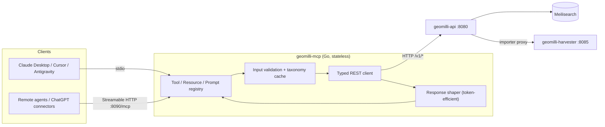
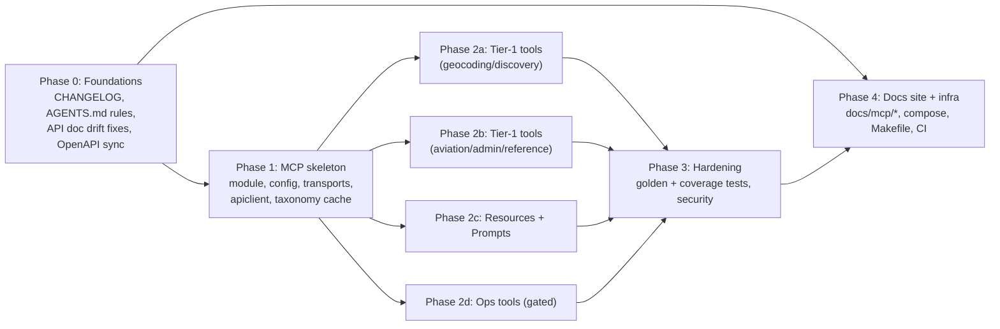

# Geomilli MCP Server — Architecture Design (RFC-001)

**Status:** Draft, waiting for approval · **Author:** Antigravity (architect role) · **Date:** 2026-10-24

---

## 1. Context: what Geomilli offers today

`geomilli-api` (Go 1.25, Chi) exposes **27 routes** under `/v1` ([handlers.go](file:///Users/a670090449/Documents/Projects/geomilli%20/geomilli-api/internal/handlers/handlers.go)). From an LLM's point of view they fall into four groups:

| Capability group | Routes | Value to an AI agent |
| :--- | :--- | :--- |
| **Geocoding & search** | `/autocomplete`, `/search`, `/reverse` | 🟢 High: "Where is X?", "What's at these coordinates?" |
| **Spatial discovery** | `/nearby`, `/bbox`, `/places/{id}`, `/places/wikidata/{qid}` | 🟢 High: "Hotels within 2 km of the Atomium", grounding facts |
| **Domain lookups** | `/airports`, `/airports/{code}`, `/countries`, `/countries/{code}/regions`, `/countries/{code}/cities` | 🟢 High: aviation, admin hierarchy |
| **Metadata** | `/taxonomy`, `GET /languages` | 🟡 Medium: tells the LLM which values it can use |
| **Operations (mutating)** | `PUT /languages`, `/importer/*` (jobs, cancel, queue, dequeue, SSE events) | 🔴 Risky: admin-only |
| **Observability** | `/metrics`, `/health`, `/openapi.json` | 🟡 Ops agents only |

### Issues found during the audit

> [!WARNING]
> These affect the MCP design because LLMs read the docs and act on the error messages. I suggest fixing them in **Phase 0**, before MCP work starts.

1. **Docs describe auth that doesn't exist.** [overview.md](file:///Users/a670090449/Documents/Projects/geomilli%20/docs/api/overview.md) documents `API_AUTH_TOKEN` Bearer auth. [config.go](file:///Users/a670090449/Documents/Projects/geomilli%20/geomilli-api/internal/config/config.go) never reads it, and no middleware checks it.
2. **The documented error format is wrong.** The docs show `{"error":{"code","message","status"}}`. [`writeError`](file:///Users/a670090449/Documents/Projects/geomilli%20/geomilli-api/internal/handlers/handlers.go) actually returns `{"error":true,"status":…,"message":…}`.
3. **`/v1/reverse` has no radius cap.** `radius_meters` is unbounded, while `/nearby` caps it at 100 km. An LLM could send `radius_meters=20000000` and trigger an expensive query.
4. **`/v1/search` passes `filter` straight to Meilisearch.** That's acceptable for the REST API, but the MCP server must **not** expose it (see §5.3).
5. **The version is hard-coded.** `"version": "1.0.0"` appears in the root handler and the VitePress nav, with no single source of truth. The changelog (§8) fixes this.
6. **The nearby docs don't match the code.** [geospatial-apis.md](file:///Users/a670090449/Documents/Projects/geomilli%20/docs/api/geospatial-apis.md) and `openapi.yaml` document the parameter as `radius` (default 1000, max 50 000). The [code](file:///Users/a670090449/Documents/Projects/geomilli%20/geomilli-api/internal/handlers/nearby.go) reads `radius_meters` (default 5000, max 100 000). Any client following the docs has its radius silently ignored.

> [!NOTE]
> Findings 1, 2 and 6 point to a wider problem: the docs were written separately from the code. Phase 0 therefore includes a **full route-by-route reconciliation** of `docs/api/*` and `openapi.yaml` against the handlers, not only point fixes.

---

## 2. Goals and non-goals

**Goals**
- Let any MCP client (Claude Desktop/Code, Cursor, Antigravity, VS Code, ChatGPT connectors) use Geomilli's geospatial intelligence through well-described tools.
- Support **both** local use (stdio binary) and hosted use (Streamable HTTP).
- Keep the REST API the **single source of truth** for business logic.
- Make documentation and changelog upkeep **enforced by process and CI**, not left to memory.

**Non-goals (v1)**
- No Studio UI integration.
- No MCP *sampling* or *elicitation* (server→client LLM calls).
- No OAuth 2.1 authorization server. v1 uses static bearer tokens; OAuth is a follow-up.
- No direct Meilisearch access from the MCP server.

---

## 3. Key architecture decision: separate adapter service

### Options considered

| | **A. New `geomilli-mcp/` service calling the REST API** ✅ | B. Embed `/mcp` inside `geomilli-api` | C. Auto-generate from OpenAPI |
| :--- | :--- | :--- | :--- |
| Coupling | Low: depends only on the public HTTP contract | High: shares handler internals | Low |
| Tool quality | Hand-designed for LLMs | Hand-designed | ❌ 1:1 endpoint mirror, poor descriptions, 27 noisy tools |
| Local stdio use against a remote API | ✅ `geomilli-mcp --api-url https://…` | ❌ Must run the whole API locally | ✅ |
| Inherits API validation, telemetry, (future) auth | ✅ | Partly | ✅ |
| Extra latency | ~1 ms HTTP hop (same network) | None | ~1 ms |
| Fits the monorepo topology | ✅ Matches the decoupled microservice pattern | ❌ | ✅ |

**Decision: Option A.** It's a thin, **stateless** Go service that translates MCP tool calls into REST calls. It scales horizontally like `geomilli-api` and adds no shared state.



### Technology choices

| Concern | Choice | Rationale |
| :--- | :--- | :--- |
| Language | Go 1.25 | Same as the API and harvester, so the same toolchain, CI and Docker patterns |
| MCP SDK | Official `github.com/modelcontextprotocol/go-sdk` (pin the latest stable v1.x at implementation time) | Maintained with Google and in step with the spec. Typed tool handlers with JSON-schema inference. In-memory transports for tests |
| Transports | **stdio** (default) and **Streamable HTTP in stateless mode** | Legacy HTTP+SSE transport is deprecated and won't be implemented |
| Dependencies | SDK + stdlib only (no Chi needed) | Small attack surface |

---

## 4. Module layout

```text
geomilli-mcp/
├── cmd/geomilli-mcp/main.go        # flags/env → transport selection, graceful shutdown
├── internal/
│   ├── config/                     # env + flags (no globals)
│   ├── apiclient/                  # typed client for /v1/* (only the subset we use)
│   │   └── types.go                # response DTOs mirroring geomilli-api JSON
│   ├── taxonomy/                   # fetches /v1/taxonomy + /v1/languages, TTL cache
│   ├── shape/                      # Place → compact LLM view, text summaries
│   ├── tools/                      # one file per tool group
│   │   ├── geocoding.go            # geocode, reverse_geocode
│   │   ├── discovery.go            # search_places, find_nearby, places_in_area, get_place
│   │   ├── aviation.go             # find_airports, get_airport
│   │   ├── admin_hierarchy.go      # list_countries, list_regions, list_cities
│   │   ├── reference.go            # list_place_categories, measure_distance
│   │   └── operations.go           # gated admin tools
│   ├── resources/                  # geomilli:// resources
│   ├── prompts/                    # prompt templates
│   └── server/                     # wiring: registers everything, version info
├── testdata/golden/                # tool schema snapshots
├── Dockerfile
├── Makefile
└── README.md
```

---

## 5. MCP surface design

### 5.1 Design principles for tools

1. **Design around intent, not endpoints.** Tools are named after what the user wants (`find_nearby`, `geocode`), not after REST paths.
2. **Use structured parameters only.** Never expose raw Meilisearch filter syntax.
3. **Build enums from config.** The `class` and `lang` enums in input schemas come from `/v1/taxonomy` and `/v1/languages` at startup. Nothing is hard-coded, as required by AGENTS.md §3.C.
4. **Keep output token-efficient.** Return `structuredContent` (with `outputSchema`) **and** a short text summary. Strip `names_by_language`, `name_alt_historical`, `updated_at` and `source` unless asked. Default `limit` is 10, maximum 25.
5. **Write errors the LLM can act on.** Return `isError: true` with a message that tells it how to recover, e.g. *"Unknown class 'Restaurants'. Valid classes: Restaurant, Cafe, … Call list_place_categories for details."*
6. **Annotate every tool.** Set `readOnlyHint`, `destructiveHint`, `idempotentHint` and `openWorldHint` on each one.

### 5.2 Tool catalog (v1)

**Tier 1: public, read-only (always on)**

| Tool | Maps to | Key inputs | Notes |
| :--- | :--- | :--- | :--- |
| `geocode` | `/v1/autocomplete` | `query`*, `country`, `class`, `near{lat,lng}`, `lang`, `limit≤10` | Forward geocoding: name → candidates with coordinates. Use it first to turn names into IDs/coords |
| `reverse_geocode` | `/v1/reverse` | `lat`*, `lng`*, `lang` | Address, admin hierarchy, closest place. MCP caps the radius |
| `search_places` | `/v1/search` | `query`, `class`, `subclass`, `country`, `cuisine`, `star_rating`, `lang`, `limit`, `offset` | Full-text plus structured filters. Optional `include_facets` |
| `find_nearby` | `/v1/nearby` | `lat`*, `lng`*, `radius_meters≤50000`, `class`, `subclass`, `cuisine`, `min_stars`, `limit` | Results sorted by distance, with `distance_meters` |
| `places_in_area` | `/v1/bbox` | `min_lat`*,`min_lng`*,`max_lat`*,`max_lng`*, `class`, `limit≤25` | Validates that the bbox is sane (min < max, area cap) |
| `get_place` | `/v1/places/{id}` or `/v1/places/wikidata/{qid}` | `id` **xor** `wikidata_id`, `include_nearby`, `lang`, `verbose` | `verbose=true` returns all names and aliases |
| `find_airports` | `/v1/airports` | `query`, `country`, `iata`, `icao`, `near{lat,lng}`, `limit` | |
| `get_airport` | `/v1/airports/{code}` | `code`* (IATA or ICAO) | |
| `list_countries` | `/v1/countries` | — | Also tells the agent **which data is indexed** |
| `list_regions` | `/v1/countries/{code}/regions` | `country_code`* | |
| `list_cities` | `/v1/countries/{code}/cities` | `country_code`*, `limit`, `offset` | |
| `list_place_categories` | `/v1/taxonomy` | — | Compact class/subclass list for the LLM (not the raw match rules) |
| `measure_distance` | composite (`get_place` ×2 + Haversine) | `from`*, `to`* (place id **or** `{lat,lng}`) | Pure computation. Answers "how far is X from Y" without the LLM doing the math |

**Tier 2: operations (off by default; `MCP_ENABLE_OPS_TOOLS=true`)**

| Tool | Maps to | Annotations |
| :--- | :--- | :--- |
| `get_service_status` | `/v1/health` + `/v1/importer/status` + `/v1/metrics` (summary) | read-only |
| `list_import_queue` | `GET /v1/importer/queue` | read-only |
| `list_importable_countries` | `GET /v1/importer/countries` | read-only |
| `queue_country_import` | `POST /v1/importer/jobs` | non-destructive, not idempotent |
| `cancel_import` | `POST /v1/importer/cancel` | **destructive** |
| `clear_import_queue` | `DELETE /v1/importer/queue` | **destructive** |

**Never exposed:** `PUT /v1/languages` (index-wide config change, belongs in the Studio UI), `/v1/importer/events` (an SSE stream doesn't fit request/response tools), `/v1/openapi.json`, and `POST /v1/importer/queue/dequeue` (`cancel_import` covers it).

### 5.3 Why no raw `filter` parameter

Exposing Meilisearch filter syntax to an LLM causes (a) frequent syntax errors and hallucinated attributes, and (b) a prompt-injection path: text pulled from a web page could steer arbitrary filters. Structured params are validated, then the **API** builds the filter.

### 5.4 Resources

| URI | Content | MIME |
| :--- | :--- | :--- |
| `geomilli://taxonomy` | Full taxonomy (classes, subclasses, attributes) | `application/json` |
| `geomilli://languages` | Supported language whitelist | `application/json` |
| `geomilli://countries` | Indexed countries + counts | `application/json` |
| `geomilli://schema/place` | Field dictionary for the `Place` document (what `popularity_score`, `admin_level`, etc. mean) | `text/markdown` |
| `geomilli://places/{id}` *(template)* | Full place document | `application/json` |

Some clients have weak resource support, so every resource also has a tool equivalent.

### 5.5 Prompts (workflow templates)

| Prompt | Args | Workflow |
| :--- | :--- | :--- |
| `explore_area` | `place`, `interests?` | geocode → find_nearby per interest → summary |
| `describe_location` | `lat`, `lng` | reverse_geocode → find_nearby → narrative |
| `plan_airport_transfer` | `city` | find_airports near city → distance ranking |

### 5.6 Compact Place view (output contract)

```json
{
  "id": "osm_n123", "name": "Atomium", "class": "Attraction", "subclass": "monument",
  "lat": 50.8949, "lng": 4.3415, "country_code": "BE",
  "admin_hierarchy": ["Laeken", "Brussels", "Brussels-Capital Region", "Belgium"],
  "wikidata_id": "Q207", "popularity_score": 0.91, "distance_meters": 412
}
```
Optional fields such as `iata_code`, `star_rating`, `cuisine` and `population` appear only when present.

---

## 6. Configuration

| Env var | Flag | Default | Purpose |
| :--- | :--- | :--- | :--- |
| `GEOMILLI_API_URL` | `--api-url` | `http://localhost:8080` | Upstream REST API |
| `GEOMILLI_API_TOKEN` | `--api-token` | — | Forwarded as `Authorization: Bearer` (ready for when the API adds auth) |
| `MCP_TRANSPORT` | `--transport` | `stdio` | `stdio` \| `http` |
| `MCP_HTTP_ADDR` | `--http-addr` | `127.0.0.1:8090` | Bound to loopback by default; Docker sets `0.0.0.0:8090` |
| `MCP_AUTH_TOKEN` | — | — | Required bearer token for the HTTP transport (refuses to start on a non-loopback address without it) |
| `MCP_ALLOWED_ORIGINS` | — | — | `Origin` header allowlist (spec-mandated DNS-rebinding protection) |
| `MCP_ENABLE_OPS_TOOLS` | `--enable-ops-tools` | `false` | Registers Tier 2 tools |
| `MCP_DEFAULT_LANG` | `--lang` | — | Default `lang` for localized names |
| `MCP_REQUEST_TIMEOUT` | — | `10s` | Per upstream call |
| `MCP_TAXONOMY_TTL` | — | `10m` | Refresh interval for the enum cache |

---

## 7. Cross-cutting concerns

- **Security:** Ops tools are opt-in. HTTP transport requires `MCP_AUTH_TOKEN` when not on loopback, and validates `Origin`. All inputs are validated and clamped before the upstream call. Tokens are never logged.
- **stdio safety:** Logs go **only to stderr** (`log/slog`, JSON). Writing to stdout corrupts the stdio protocol.
- **Observability:** The upstream client sends `User-Agent: geomilli-mcp/<version>` and `X-Geomilli-Client: mcp`, so API telemetry can attribute MCP traffic. Each tool call is logged as `tool`, `duration_ms`, `upstream_status`, `is_error`.
- **Resilience:** Context timeouts per call. Upstream 5xx and timeouts become tool errors, not protocol errors. If the taxonomy cache is cold, schemas fall back to free-text `class` validated by the API.
- **Versioning:** The MCP server has its own SemVer. `serverInfo.version` is injected via `-ldflags` and matches the `CHANGELOG.md` entry.

---

## 8. Documentation, changelog and agent governance

### 8.1 New docs section `docs/mcp/`

| Page | Content |
| :--- | :--- |
| `overview.md` | What and why, architecture diagram, local vs hosted |
| `client-setup.md` | Copy-paste configs for Claude Desktop, Claude Code, Cursor, VS Code, Antigravity; Docker and binary install |
| `tools-reference.md` | Every tool: purpose, inputs, output example, annotations, mapped endpoint |
| `resources-and-prompts.md` | Resource URIs, prompt templates |
| `security-and-deployment.md` | Transports, tokens, origins, ops-tool gating, scaling |

Also: sidebar and nav entries in [config.mts](file:///Users/a670090449/Documents/Projects/geomilli%20/docs/.vitepress/config.mts), a `geomilli-mcp/README.md`, and a "Connect an AI agent" section in the root README.

### 8.2 `CHANGELOG.md` (new, repo root)

- Format: **[Keep a Changelog 1.1.0](https://keepachangelog.com/en/1.1.0/)** + **SemVer**, one root file for the monorepo.
- Each entry starts with a component tag: `**api**`, `**mcp**`, `**harvester**`, `**studio**`, `**docs**`, `**infra**`.
- An `## [Unreleased]` section always sits at the top. Agents append there; releases rename it.
- Seeded with `[1.0.0]` (reconstructed from git history) plus an `[Unreleased]` entry for the MCP work.
- Rendered on the docs site through `docs/changelog.md` → `<!--@include: ../CHANGELOG.md-->`, so the two never drift.

### 8.3 Agent rules (how agents know to keep docs current)

Updates to [AGENTS.md](file:///Users/a670090449/Documents/Projects/geomilli%20/.agents/AGENTS.md) and [CLAUDE.md](file:///Users/a670090449/Documents/Projects/geomilli%20/CLAUDE.md):

1. §1 topology table: add the `geomilli-mcp/` row.
2. New §3.H **MCP constraints**: adapter-only (no Meili access), no raw filter exposure, enums from config, stderr-only logs, ops tools gated, stateless.
3. §4 protocol, new triggers:
   - *API endpoint or parameter change* → **also** assess MCP impact: update the tool/mapping, `docs/mcp/tools-reference.md` and the golden schemas.
   - *MCP tool/resource/prompt change* → update `docs/mcp/*`.
   - **Every** user-visible change → add an entry under `[Unreleased]` in `CHANGELOG.md`.
4. A "Definition of Done" checklist that agents must self-verify before reporting completion.

### 8.4 CI enforcement (mechanical checks)

| Check | Mechanism |
| :--- | :--- |
| **API ↔ MCP coverage test** | Go test in `geomilli-mcp` parses `docs/api/openapi.yaml`. Every operation must appear in either the tool mapping table or an explicit `excluded` list with a reason. A new endpoint therefore fails CI until someone decides on it |
| **Tool schema golden test** | Snapshots of all tool input/output schemas. Unintended contract changes fail; intended ones need `-update` plus a changelog entry |
| **Changelog guard** | CI job: if a PR touches `geomilli-*/**` or `config/**` and not `CHANGELOG.md`, fail (bypass with the `skip-changelog` label) |
| **PR template** | `.github/pull_request_template.md` checklist: docs, changelog, MCP impact, `make test` |
| Build/test/Docker | New `test-mcp` job + Dockerfile validation in [ci.yml](file:///Users/a670090449/Documents/Projects/geomilli%20/.github/workflows/ci.yml) |

> [!IMPORTANT]
> The coverage test depends on `docs/api/openapi.yaml` being accurate. Phase 0 includes reconciling it with the 27 real routes.

---

## 9. Testing strategy

| Layer | Approach |
| :--- | :--- |
| Unit | `apiclient` against `httptest.Server` fixtures; `shape` and validation pure-function tests |
| Protocol | SDK in-memory client↔server transports: `tools/list`, `tools/call` happy and error paths, annotations present |
| Contract | Golden schemas + OpenAPI coverage test (§8.4) |
| Integration | `make up` cluster + scripted MCP client run against real Belgium data (`COUNTRIES=BE`) |
| Manual | `make mcp-inspect` → MCP Inspector |

---

## 10. Delivery phases (preview; detailed task cards follow approval)



Phases 2a–2d can run **in parallel on separate agents** once Phase 1 has landed the shared skeleton (registry, `apiclient`, `shape`).

---

## 11. Phase 0 fixes for the audit findings

### 11.1 Finding 1: API auth → correct the docs now, build the feature later
- **Now:** rewrite `docs/api/overview.md` §2 to say *"The API currently runs without authentication. Protect it at the network edge (reverse proxy, private network). Built-in Bearer auth is planned (see issue)."* Remove `bearerAuth` from `openapi.yaml` if it's present.
- **Later:** a GitHub issue is drafted (see the decision log) with the full design: constant-time compare, exempt routes, optional admin token.

### 11.2 Finding 2: error envelope → make the code match the documented format
The documented format is the better contract, because a machine-readable `code` lets the MCP server and other clients branch on error type:

```json
{ "error": { "code": "invalid_parameter", "message": "Parameter 'lat' must be between -90 and 90", "status": 400 } }
```

| `code` | HTTP | Used when |
| :--- | :--- | :--- |
| `missing_parameter` | 400 | A required query or path param is absent |
| `invalid_parameter` | 400 | A param is malformed or out of range |
| `invalid_body` | 400 | Malformed JSON payload |
| `not_found` | 404 | Place, airport or country not found |
| `upstream_unavailable` | 502 / 503 | Meilisearch or harvester unreachable |
| `internal_error` | 500 | Anything else |
| `unauthorized` | 401 | *Reserved for the future auth issue* |

- Replace `writeError(w, status, msg)` with `writeError(w, status, code, msg)`. Codes are typed constants in `handlers/errors.go`. Update all **39 call sites**.
- **Studio:** audit the fetch/error parsing (Playground, Importer, LanguageManager) and update it **in the same PR**.
- Tests assert the envelope shape for every error path.
- **CHANGELOG:** `**api** Changed — ⚠️ BREAKING: error responses now use the {error:{code,message,status}} envelope.` Studio is the only known consumer, so we do a clean switch with no transition period.

### 11.3 Finding 3 (+6): unbounded/inconsistent radius → shared, documented limits
- New `handlers/params.go` with shared parsers (`parseLatLng`, `parseRadius`, `parseLimit`, `parseOffset`). Limits are **constants defined once**:

| Endpoint | Param | Default | Max |
| :--- | :--- | :--- | :--- |
| `/v1/nearby` | `radius_meters` | 5 000 | 100 000 |
| `/v1/reverse` | `radius_meters` | 50 000 | **100 000** (new cap) |

- Out-of-range values are **clamped**, as `/nearby` already does. Every response **echoes the effective `radius_meters`**, so callers can see when clamping happened.
- Fix finding 6 in docs and OpenAPI: `radius` → `radius_meters`, plus the correct default and max.
- Table-driven tests for every parser and the clamp behaviour.

### 11.4 Full docs ↔ code reconciliation (covers 1, 2, 6 and any undiscovered drift)
The handler code is the source of truth. For **each of the 27 routes** in `RegisterRoutes`, compare against `docs/api/overview.md`, `autocomplete-and-search.md`, `geospatial-apis.md` and `openapi.yaml`:

| Check | Example of drift it catches |
| :--- | :--- |
| Route exists in docs and OpenAPI (and nothing documented is missing from code) | Routes added to the router without a doc update (not yet verified for `/v1/importer/*`, `/v1/countries/*`) |
| Query and path param **names** | `radius` vs `radius_meters` |
| **Defaults, max limits**, required/optional | nearby default 1000 vs 5000, max 50 000 vs 100 000 |
| Response field names and shapes (from the Go structs) | `ReverseResponse`, `CitiesListResponse` |
| Error envelope and status codes | Finding 2 |
| Auth statements | Finding 1 |
| cURL examples actually run against `make up` | Wrong param names in examples |

**Deliverables:** corrected docs and `openapi.yaml` (it becomes the contract that the MCP coverage test in §8.4 relies on), plus a short drift report in the PR description listing each mismatch and how it was fixed. A future improvement is to generate `openapi.yaml` from the code, or test it against the router. That is out of scope here, but the §8.4 coverage test plus a router↔OpenAPI route-list test (added in this task) catch new route drift from now on.

### 11.5 Finding 5: single source of truth for the version
- `geomilli-api` gets `var Version = "dev"`, injected via `-ldflags "-X …Version=…"` in the Makefile and Dockerfile. Used by `GET /` and the `info.version` field of `/v1/openapi.json`.
- The VitePress nav label reads the version from `CHANGELOG.md`'s latest release header (or a root `VERSION` file) instead of the hard-coded `v1.0.0`.
- `geomilli-mcp` follows the same pattern (§7).

---

## 12. Decision log

| # | Decision | Status |
| :--- | :--- | :--- |
| D1 | Separate stateless `geomilli-mcp` adapter (Option A) | Proposed |
| D2 | API auth: correct docs now; build the feature later via a GitHub issue | ✅ Decided (user) |
| D3 | Fix findings 2 and 3 (+6) in Phase 0 (§11) | ✅ Decided (user) |
| D3b | Full docs ↔ code reconciliation of all 27 routes (§11.4) and version single source of truth (§11.5) in Phase 0 | Proposed |
| D4 | **Changelog guard: hard-fail CI**, with a `skip-changelog` label escape hatch. Only triggers on changes under `geomilli-*/**` and `config/**`, so docs-only and CI-only PRs aren't affected | ✅ Decided (architect) |
| D5 | Compose: `geomilli-mcp` behind an opt-in profile (`docker compose --profile mcp up`, `make up-mcp`), so the default `make up` stays unchanged | ✅ Decided (architect) |
| D6 | Operations tools: v1 scope | ⏳ Waiting for user |

**Why D4 is a hard fail:** most changes in this repo will be made by agents. Agents reliably fix red CI but tend to skip soft warnings. Path filtering and the label keep false positives cheap.
