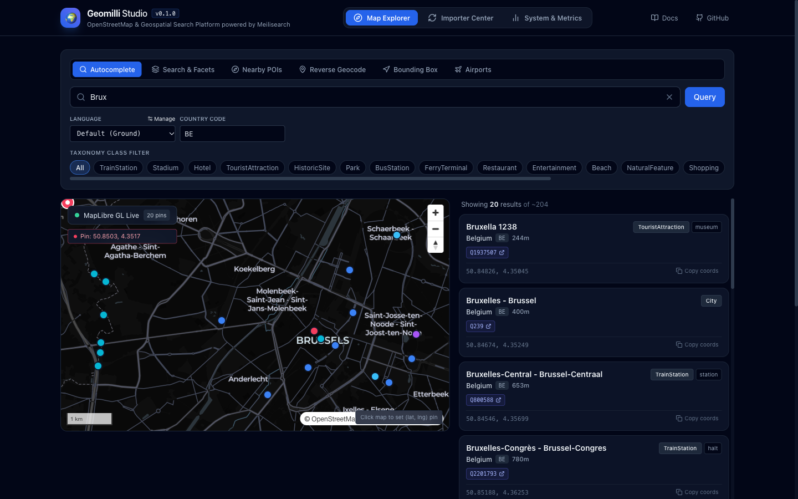
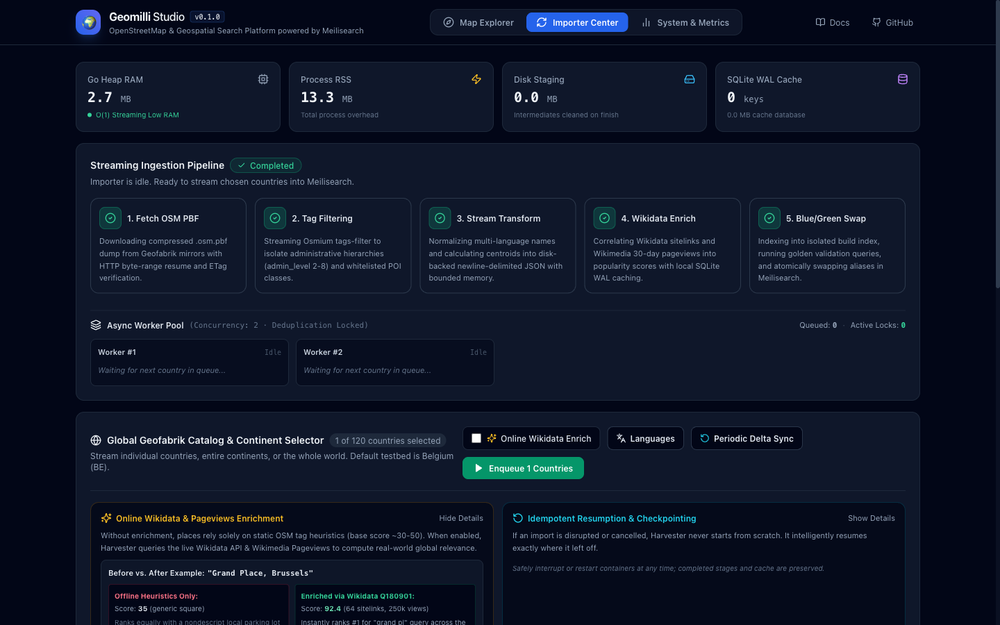
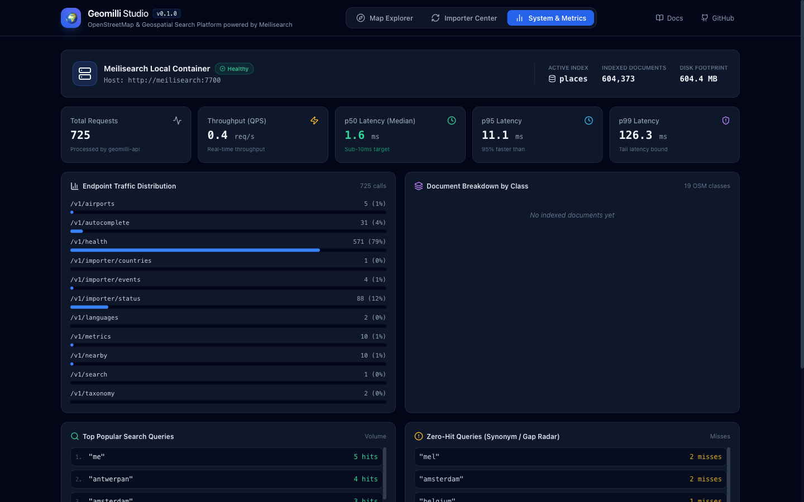
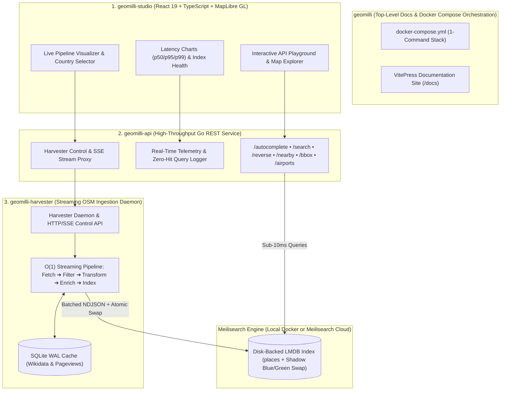

<div align="center">

# 🌍 Geomilli

**High-Performance OpenStreetMap Intelligence & Geospatial Search Platform Powered by Meilisearch**

[](https://opensource.org/licenses/Apache-2.0)
[](https://golang.org)
[](https://www.meilisearch.com)
[](https://www.docker.com)
[](https://www.openstreetmap.org)
[](https://obaid22192.github.io/geomilli/)

<p align="center">
  <a href="#-60-second-quickstart">Quickstart</a> •
  <a href="#-geomilli-studio-ui">Studio UI</a> •
  <a href="#-system-architecture">Architecture</a> •
  <a href="#-sub-repositories">Repositories</a> •
  <a href="#-api-preview">API Preview</a> •
  <a href="#-key-features">Features</a> •
  <a href="https://obaid22192.github.io/geomilli/">Documentation</a>
</p>

</div>

---

## ⚡ What is Geomilli?

**Geomilli** transforms raw OpenStreetMap datasets into a lightning-fast geospatial search engine. Designed around an **O(1) memory, disk-backed streaming pipeline**, Geomilli ingests single countries or planetary datasets on modest hardware with a Go heap footprint under **50 MB RAM**.

With sub-10ms response times, typo tolerance, geo-proximity sorting, and 19 normalized taxonomy classes, Geomilli delivers production-grade autocomplete, faceted discovery, reverse geocoding, and aviation intelligence out of the box.

---

## 🖥️ Geomilli Studio UI

Geomilli Studio is an interactive developer console and telemetry dashboard built with React 19, TypeScript, and MapLibre GL.

### 1. Interactive Map Explorer & Multi-Mode API Playground
Test sub-10ms prefix autocomplete, geospatial radius searches, bounding-box queries, and airport resolutions against live Meilisearch indexes with instant vector tile visualization and JSON inspection.

<p align="center">
  
</p>

### 2. Importer Center & Live Pipeline Visualizer
Launch and orchestrate streaming ingestion jobs across worldwide countries with real-time SSE progress tracking, country deduplication locks, memory/disk gauges, and live daemon logs.

<p align="center">
  
</p>

### 3. Real-Time Telemetry & Observability
Monitor endpoint throughput (QPS), latency percentiles ($p_{50}$, $p_{95}$, $p_{99}$), zero-hit search queries, status-code distributions, and Meilisearch engine statistics with zero external observability dependencies.

<p align="center">
  
</p>

---

## 🏗️ System Architecture



---

## 📦 Decoupled Sub-Repositories

This umbrella repository orchestrates three decoupled, production-grade microservices:

| Repository | Responsibility | Tech Stack |
| :--- | :--- | :--- |
| **[`geomilli-harvester`](./geomilli-harvester)** | Streaming OpenStreetMap ingestion pipeline, Wikidata enricher, and SSE control daemon. Operates with bounded buffers (< 50MB RAM). | Go 1.25, `osmium-tool`, SQLite (WAL) |
| **[`geomilli-api`](./geomilli-api)** | High-throughput REST API serving autocomplete, search, reverse geocoding, airport lookups, and usage telemetry. | Go 1.25, Chi / stdlib, Meilisearch Go SDK |
| **[`geomilli-studio`](./geomilli-studio)** | Developer console, interactive multi-mode MapLibre playground, live importer visualizer, and telemetry charts. | React 19, TypeScript, Tailwind CSS, MapLibre GL |

---

## 🚀 60-Second Quickstart

By default, Geomilli is pre-configured to ingest and index **Belgium (`BE`)** from Geofabrik (~70MB download, ready in ~60–90 seconds):

```bash
# 1. Clone umbrella repository
git clone https://github.com/geomilli/geomilli.git
cd geomilli

# 2. Copy environment template (defaults to COUNTRIES=BE)
cp .env.example .env

# 3. Spin up all services with Docker Compose
docker compose up -d --build
```

### Access Services:
- **Geomilli Studio (UI)**: [http://localhost:3333](http://localhost:3333) (or [http://localhost:3000](http://localhost:3000))
- **Meilisearch Admin UI**: [http://localhost:7701](http://localhost:7701)
- **Geomilli API**: [http://localhost:8080](http://localhost:8080)
- **Harvester Daemon**: [http://localhost:8085](http://localhost:8085)
- **Meilisearch Engine**: [http://localhost:7700](http://localhost:7700)
- **Hosted Documentation**: [https://obaid22192.github.io/geomilli/](https://obaid22192.github.io/geomilli/)

---

## 🔎 API Preview

### 1. Sub-10ms Autocomplete
```bash
curl -s "http://localhost:8080/v1/autocomplete?q=Brux&lang=fr" | jq .
```
```json
{
  "hits": [
    {
      "id": "relation_54094",
      "name": "Bruxelles",
      "class": "City",
      "subclass": "city",
      "country_code": "BE",
      "names_by_language": {
        "en": "Brussels",
        "fr": "Bruxelles",
        "nl": "Brussel"
      },
      "_geo": { "lat": 50.8466, "lng": 4.3528 },
      "popularity_score": 98.4
    }
  ],
  "processingTimeMs": 2
}
```

### 2. Reverse Geocoding
```bash
# Resolves administrative hierarchy and nearest street landmark
curl -s "http://localhost:8080/v1/reverse?lat=50.8467&lng=4.3525" | jq .
```

### 3. Nearby POIs (Geo-Radius)
```bash
# Belgian restaurants within 1.5 km of the Grand Place
curl -s "http://localhost:8080/v1/nearby?lat=50.8467&lng=4.3525&radius=1500&class=Restaurant&cuisine=belgian" | jq .
```

### 4. Aviation & Airport Resolution
```bash
# Resolve airports by 3-letter IATA or 4-letter ICAO code
curl -s "http://localhost:8080/v1/airports/BRU" | jq .
```

---

## ✨ Key Features

- **⚡ Sub-10ms Autocomplete**: Instant prefix search with typo tolerance and geo-proximity ranking.
- **💾 O(1) Memory Footprint**: Strictly bounded buffers (<50MB RAM) and zero in-memory accumulator maps.
- **🏛️ 19 Taxonomy Classes**: Structured mapping from Countries and Cities to Airports, Hotels, and Restaurants.
- **🔄 Async Worker Queue & Deduplication**: Bounded concurrent worker pool (`HARVESTER_CONCURRENCY=2`) with country mutex locks to prevent duplicate or overlapping processing.
- **🌐 Config-Driven Multilingualism**: Whitelisted languages (`config/languages.yaml`) prevent index bloat.
- **🔄 Zero-Downtime Blue/Green Swaps**: Meilisearch shadow index builds with atomic swap on completion.
- **🛡️ Resilient Enrichment**: SQLite WAL cache, token bucket rate limiter, and automatic circuit breaker for Wikimedia APIs.
- **☁️ Local or Cloud**: Switch from local container to [Meilisearch Cloud](https://cloud.meilisearch.com) with a single environment flag.

---

## ☁️ Deploying with Meilisearch Cloud

To use a managed Meilisearch Cloud cluster instead of a local container:

```bash
# Set your cloud credentials in .env
MEILI_HOST=https://ms-xxxx.sfo.meilisearch.io
MEILI_API_KEY=your_cloud_admin_api_key

# Run using the cloud compose override
docker compose -f docker-compose.yml -f docker-compose.cloud.yml up -d --build
```

---

## 🛠️ Makefile Commands

| Command | Description |
| :--- | :--- |
| `make up` | Start all 4 containers with Docker Compose |
| `make down` | Stop all containers |
| `make logs` | Stream live logs from all services |
| `make test` | Run test suites across harvester, API, and docs |
| `make build` | Compile all Go binaries and frontend bundles |
| `make docs` | Start local VitePress documentation server |
| `make up-cloud` | Start services connected to external Meilisearch Cloud |

---

## 📖 Documentation

The complete documentation is hosted on GitHub Pages at **[https://obaid22192.github.io/geomilli/](https://obaid22192.github.io/geomilli/)**.

You can also run the local VitePress documentation server with:

```bash
make docs
```

Topics covered:
- [60-Second Quickstart](docs/guide/quickstart.md)
- [System Architecture](docs/guide/architecture.md)
- [O(1) Streaming & Memory](docs/guide/streaming-and-memory.md)
- [Meilisearch: Local vs Cloud](docs/guide/meilisearch-local-vs-cloud.md)
- [Harvester Configuration & Countries](docs/harvester/configuration.md)
- [Taxonomy & Languages](docs/harvester/taxonomy-and-languages.md)
- [Enrichment & SQLite WAL Caching](docs/harvester/enrichment-and-caching.md)
- [REST API Reference & OpenAPI 3.1](docs/api/overview.md)
- [Geomilli Studio Guide](docs/studio/playground-and-metrics.md)

---

## 📄 License

Geomilli is open-source software licensed under the [Apache 2.0 License](LICENSE).
OpenStreetMap data is licensed under the [ODbL](https://www.openstreetmap.org/copyright).
