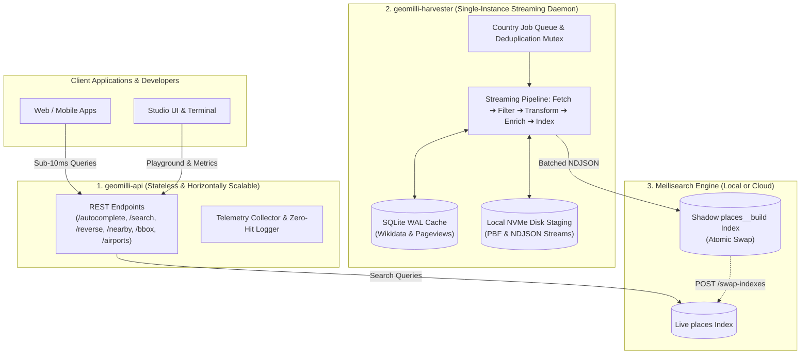

<div align="center">

# 🌍 Geomilli

**High-Performance Geospatial Search API & OpenStreetMap Ingestion Engine Powered by Meilisearch**

[](https://opensource.org/licenses/Apache-2.0)
[](https://golang.org)
[](https://www.meilisearch.com)
[](https://www.docker.com)
[](https://www.openstreetmap.org)
[](https://obaid22192.github.io/geomilli/)

<p align="center">
  <a href="#-what-is-geomilli">Overview</a> •
  <a href="#-core-feature-1-search--geospatial-rest-api">REST API</a> •
  <a href="#-core-feature-2-streaming-ingestion-engine">Harvester Engine</a> •
  <a href="#-core-feature-3-model-context-protocol-mcp-server">MCP Server</a> •
  <a href="#-scalability--architectural-limitations">Scalability & Limits</a> •
  <a href="#-60-second-quickstart">Quickstart</a> •
  <a href="#-developer-console-geomilli-studio">Studio UI</a> •
  <a href="https://obaid22192.github.io/geomilli/">Documentation</a>
</p>

</div>

---

## ⚡ What is Geomilli?

**Geomilli** is an open-source geospatial platform consisting of three core engines:
1. **`geomilli-harvester`**: A streaming OpenStreetMap (OSM) ingestion daemon that downloads PBF data, extracts entities using Osmium, normalizes them into 19 canonical taxonomy classes, enriches records with Wikidata and Wikipedia pageviews, and indexes them into Meilisearch via zero-downtime blue/green shadow index swaps.
2. **`geomilli-api`**: A high-throughput, low-latency Go REST API delivering sub-10ms prefix autocomplete, faceted search, reverse geocoding, bounding-box queries, and aviation lookups with typo tolerance and geo-proximity ranking.
3. **`geomilli-mcp`**: A stateless Model Context Protocol (MCP) server exposing 16 geospatial tools, 5 context resources, and 3 workflow prompts to AI coding assistants and LLMs over `stdio` and Streamable HTTP.

A lightweight developer console, **`geomilli-studio`**, is included for live map exploration, importer control, and telemetry monitoring.

---

## 📦 Monorepo Architecture

The repository orchestrates decoupled, production-grade microservices:

| Subproject | Responsibility | Tech Stack |
| :--- | :--- | :--- |
| **[`geomilli-api`](./geomilli-api)** | High-throughput REST API serving autocomplete, search, reverse geocoding, airport lookups, and telemetry. | Go 1.25, Chi / stdlib, Meilisearch Go SDK |
| **[`geomilli-harvester`](./geomilli-harvester)** | Streaming OpenStreetMap ingestion daemon, C++ Osmium filtering, Wikidata enricher, and Meilisearch indexer. | Go 1.25, `osmium-tool`, SQLite (WAL) |
| **[`geomilli-mcp`](./geomilli-mcp)** | Model Context Protocol adapter exposing geospatial tools, resources, and prompts over stdio and Streamable HTTP (:8090). | Go 1.25, official `modelcontextprotocol/go-sdk` |
| **[`geomilli-studio`](./geomilli-studio)** | Developer console, interactive MapLibre playground, live importer monitor, and telemetry charts. | React 19, TypeScript, Tailwind CSS, MapLibre GL |
| **[`docs`](./docs)** | Full developer documentation site with client-rendered Mermaid diagrams. | VitePress, `vitepress-plugin-mermaid` |



---

## 🔎 Core Feature 1: Search & Geospatial REST API (`geomilli-api`)

The API service is built in Go on top of the Chi router and Meilisearch Go SDK. It provides sub-10ms search capabilities with multilingual support:

### 1. Sub-10ms Prefix Autocomplete (`/v1/autocomplete`)
Instant keystroke suggestions with typo tolerance, localized display names, and geo-proximity ranking:
```bash
curl -s "http://localhost:8080/v1/autocomplete?q=Brux&lang=fr" | jq .
```
```json
{
  "query": "Brux",
  "took_ms": 2,
  "total_hits": 10,
  "results": [
    {
      "id": "relation_54094",
      "name_display": "Bruxelles",
      "class": "City",
      "subclass": "city",
      "country_code": "BE",
      "names_by_language": {
        "en": "Brussels",
        "fr": "Bruxelles",
        "nl": "Brussel"
      },
      "_geo": { "lat": 50.8466, "lng": 4.3528 },
      "popularity_score": 98.4
    }
  ]
}
```

### 2. Full-Text & Faceted Search (`/v1/search`)
Query across destinations, categories, and attributes with real-time facet distributions:
```bash
# Search Italian restaurants with 4+ stars in Belgium
curl -s "http://localhost:8080/v1/search?class=Restaurant&cuisine=italian&star_rating=4&country=BE" | jq .
```

### 3. Reverse Geocoding (`/v1/reverse`)
Resolves coordinates to enclosing administrative hierarchies and nearest landmarks:
```bash
curl -s "http://localhost:8080/v1/reverse?lat=50.8467&lng=4.3525" | jq .
```

### 4. Nearby POIs (Geo-Radius Search, `/v1/nearby`)
Returns places within a given radius (meters) sorted by distance or popularity:
```bash
curl -s "http://localhost:8080/v1/nearby?lat=50.8467&lng=4.3525&radius_meters=1500&class=TouristAttraction" | jq .
```

### 5. Aviation & Airport Resolution (`/v1/airports`)
Search airports by free-text, 3-letter IATA code, 4-letter ICAO code, or country:
```bash
# Lookup by path code
curl -s "http://localhost:8080/v1/airports/BRU" | jq .

# Search by IATA filter or country
curl -s "http://localhost:8080/v1/airports?iata=CRL" | jq .
curl -s "http://localhost:8080/v1/airports?country=BE&limit=25" | jq .
```

---

## 🚜 Core Feature 2: Streaming Ingestion Engine (`geomilli-harvester`)

`geomilli-harvester` is a streaming ingestion pipeline and HTTP/SSE control daemon designed to process raw OpenStreetMap extracts:

1. **Fetch**: Streams `.osm.pbf` files for requested countries from Geofabrik mirrors.
2. **Osmium Filter**: Executes native C++ `osmium tags-filter` to isolate administrative boundaries, transportation hubs, amenities, and tourism features according to `config/taxonomy.yaml`.
3. **Transform**: Converts geometry into `.geojsonseq` via `osmium export` and transforms records into line-delimited NDJSON batches. Features are mapped to one of **19 canonical taxonomy classes** (`City`, `TrainStation`, `Hotel`, `Restaurant`, `Airport`, `Beach`, `Stadium`, etc.) and filtered through `config/languages.yaml`.
4. **Enrich**: Resolves Wikidata IDs, fetches Wikipedia pageviews, and extracts airport IATA/ICAO codes. Responses are cached locally in SQLite with WAL mode. A circuit breaker automatically disables online enrichment if 5 consecutive network errors occur.
5. **Index & Atomic Swap**: Batches documents into an isolated shadow index (`places__build_<timestamp>`), configures searchable and filterable attributes, and executes a zero-downtime `POST /swap-indexes` call upon validation.

---

## 🤖 Core Feature 3: Model Context Protocol (MCP) Server (`geomilli-mcp`)

`geomilli-mcp` is a stateless adapter exposing Geomilli's search and OpenStreetMap intelligence to AI assistants, LLM coding tools, and agent runtimes over standard MCP transports.

### Highlights
- **16 Intent-Driven Tools**: Forward/reverse geocoding, proximity search (`find_nearby`), bounding-box queries (`places_in_area`), airport resolution (`find_airports`, `get_airport`), administrative navigation (`list_countries`, `list_regions`, `list_cities`), and great-circle calculation (`measure_distance`).
- **5 Context Resources**: Inspect `geomilli://taxonomy`, `geomilli://languages`, `geomilli://countries`, `geomilli://schema/place`, and dynamic place URIs directly in LLM context.
- **3 Workflow Prompts**: Reusable agent prompts for area exploration (`explore_area`), location descriptions (`describe_location`), and transit planning (`plan_airport_transfer`).
- **Dual Transports**: Subprocess `stdio` with stderr-isolated logging, and Streamable HTTP (`:8090/mcp`) with constant-time Bearer authentication and Origin validation.

### Connect an AI Agent (60 Seconds)

Add Geomilli MCP to **Claude Desktop** (`claude_desktop_config.json`):

```json
{
  "mcpServers": {
    "geomilli": {
      "command": "/absolute/path/to/geomilli/geomilli-mcp/bin/geomilli-mcp",
      "args": ["--api-url", "http://localhost:8080"]
    }
  }
}
```

Or connect via **Claude Code (CLI)**:
```bash
claude mcp add geomilli -- /absolute/path/to/geomilli/geomilli-mcp/bin/geomilli-mcp --api-url http://localhost:8080
```

For Cursor, VS Code, Antigravity, and Docker setup, see the [MCP Client Setup Guide](docs/mcp/client-setup.md).

---

## ⚖️ Scalability & Architectural Limitations

Understanding the scaling boundaries of Geomilli components:

### 1. `geomilli-api` — Horizontally Scalable (No Scaling Limitations)
* **Architecture**: The API service is **fully stateless**. It maintains no in-memory session locks or local database state; all search and geocoding operations query Meilisearch directly.
* **How to Scale**: You can deploy **unlimited API replicas** behind any reverse proxy, load balancer, or Kubernetes Ingress (e.g. AWS ALB, Traefik, Nginx).

### 2. `geomilli-harvester` — Single-Instance Only (Disk & SQLite Bound)
* **Architecture**: The harvester relies on **local disk files** (`raw/`, `staging/`) for intermediate Osmium binary processing, line-delimited streaming, and an **embedded SQLite database** (`cache.db`) for Wikidata enrichment caching.
* **Limitation**: **`geomilli-harvester` cannot run as multiple distributed instances or horizontal replicas.** Running multiple harvester instances against shared storage or concurrent SQLite files will trigger `SQLITE_BUSY` lock contention and file race conditions.
* **How to Scale**:
  * **Scale Vertically**: Assign sufficient CPU cores and fast local NVMe storage to the harvester host/container.
  * **Worker Concurrency**: Increase internal pipeline parallelism using the `HARVESTER_CONCURRENCY` environment variable (default: `2`). The embedded worker pool processes multiple country ingestion jobs concurrently within the single daemon.

### 3. Meilisearch Engine — Disk-Backed Storage
* State is persisted on disk using LMDB. For planet-scale deployments, use high-IOPS NVMe disks or point to a managed [Meilisearch Cloud](https://cloud.meilisearch.com) cluster.

---

## 🚀 60-Second Quickstart

By default, Geomilli is pre-configured to ingest and index **Belgium (`BE`)** from Geofabrik (~70MB download, ready in ~60–90 seconds):

```bash
# 1. Clone umbrella repository
git clone https://github.com/geomilli/geomilli.git
cd geomilli

# 2. Copy environment template (defaults to COUNTRIES=BE)
cp .env.example .env

# 3. Spin up all services with Docker Compose
docker compose up -d --build
```

### Access Services:
* **Geomilli API**: [http://localhost:8080](http://localhost:8080)
* **Harvester Daemon**: [http://localhost:8085](http://localhost:8085)
* **Meilisearch Engine**: [http://localhost:7700](http://localhost:7700)
* **Geomilli Studio (UI)**: [http://localhost:3333](http://localhost:3333) (or `:3000`)
* **Documentation**: [https://obaid22192.github.io/geomilli/](https://obaid22192.github.io/geomilli/)

---

## 🖥️ Developer Console: Geomilli Studio

**Geomilli Studio** is a developer portal and operations cockpit built with React 19, TypeScript, Tailwind CSS, and MapLibre GL:

* **Interactive API Playground**: Test `/autocomplete`, `/search`, `/reverse`, `/nearby`, `/bbox`, and `/airports` with live vector maps and a **one-click cURL generator** pointing to the API on port `:8080`.
* **Importer Control Center**: Launch and monitor background country ingestion jobs with real-time Server-Sent Events (SSE) progress tracking, country deduplication locks, and daemon logs.
* **Telemetry Dashboard**: Monitor QPS throughput, latency percentiles ($p_{50}$, $p_{95}$, $p_{99}$), zero-hit queries, and Meilisearch index health without external APM dependencies.

<p align="center">
  
</p>

---

## ☁️ Deploying with Meilisearch Cloud

To use a managed Meilisearch Cloud cluster instead of a local container:

```bash
# Set your cloud credentials in .env
MEILI_HOST=https://ms-xxxx.sfo.meilisearch.io
MEILI_API_KEY=your_cloud_admin_api_key

# Run using the cloud compose override
docker compose -f docker-compose.yml -f docker-compose.cloud.yml up -d --build
```

---

## 🛠️ Makefile Commands

| Command | Description |
| :--- | :--- |
| `make up` | Start all containers with Docker Compose (Meilisearch + Harvester + API + Studio) |
| `make up-mcp` | Start all containers including the Model Context Protocol (`geomilli-mcp`) adapter |
| `make down` | Stop all running containers |
| `make logs` | Stream live logs from all services |
| `make test` | Run test suites across Harvester, API, MCP server, and documentation build |
| `make build` | Compile all Go binaries and sync docs into Studio |
| `make mcp` | Run `geomilli-mcp` locally in `stdio` transport mode |
| `make mcp-inspect` | Launch MCP Inspector against local `geomilli-mcp` |
| `make docs-build` | Build static VitePress documentation and sync to `geomilli-studio/public/docs/` |
| `make docs` | Start local live-reload VitePress docs dev server |
| `make up-cloud` | Start stack connected to external Meilisearch Cloud |

---

## 📖 Documentation

The complete documentation is hosted at **[https://obaid22192.github.io/geomilli/](https://obaid22192.github.io/geomilli/)**.

You can also run the local VitePress documentation server:
```bash
make docs
```

Topics covered:
- [System Architecture](docs/guide/architecture.md)
- [Streaming Ingestion Pipeline](docs/guide/streaming-and-memory.md)
- [Meilisearch: Local vs Cloud](docs/guide/meilisearch-local-vs-cloud.md)
- [Harvester Configuration & Countries](docs/harvester/configuration.md)
- [Taxonomy & Languages](docs/harvester/taxonomy-and-languages.md)
- [Enrichment & SQLite WAL Caching](docs/harvester/enrichment-and-caching.md)
- [REST API Reference & OpenAPI 3.1](docs/api/overview.md)
- [MCP Server Architecture & Overview](docs/mcp/overview.md)
- [MCP Client Setup Guide](docs/mcp/client-setup.md)
- [MCP Tools Reference](docs/mcp/tools-reference.md)
- [MCP Context Resources & Prompts](docs/mcp/resources-and-prompts.md)
- [MCP Security & Deployment](docs/mcp/security-and-deployment.md)
- [Geomilli Studio Guide](docs/studio/playground-and-metrics.md)

---

## 📄 License

Geomilli is open-source software licensed under the [Apache 2.0 License](LICENSE).  
OpenStreetMap data is licensed under the [ODbL](https://www.openstreetmap.org/copyright).
