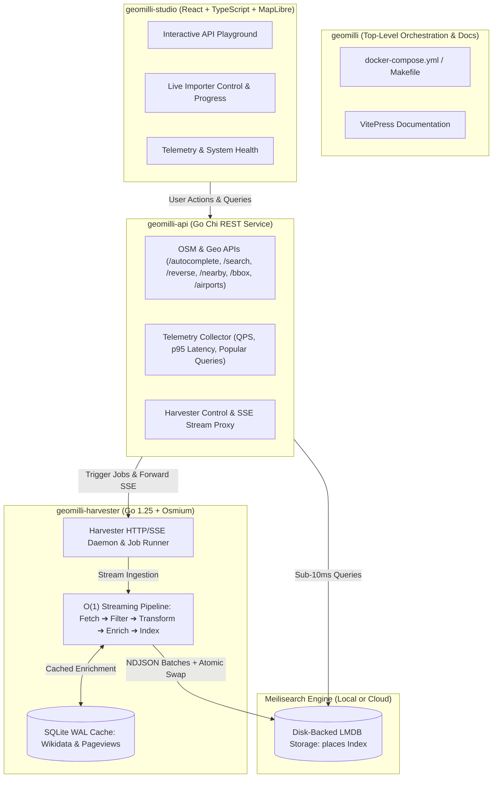
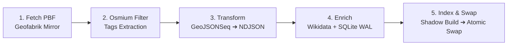
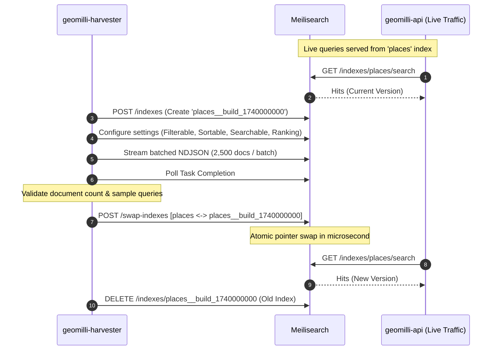
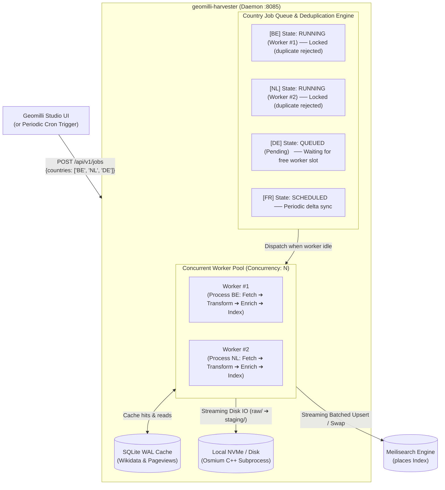

# System Architecture

Geomilli is architected as an umbrella orchestration repository housing three decoupled, production-grade microservices:

---

## 1. Repository Topology

| Subproject | Responsibility | Tech Stack |
| :--- | :--- | :--- |
| **`geomilli`** | Root repository containing documentation, Docker Compose, environment configuration, and developer orchestration. | VitePress, Docker Compose |
| **`geomilli-harvester`** | Streaming ingestion engine and control daemon. Consumes Geofabrik PBF files, transforms tags, enriches with Wikidata, and indexes into Meilisearch. | Go 1.25, `osmium-tool`, SQLite (WAL) |
| **`geomilli-api`** | High-throughput REST API serving autocomplete, search, reverse geocoding, airport lookups, and telemetry. | Go 1.25 (stdlib / Chi), Meilisearch Go SDK |
| **`geomilli-studio`** | Interactive developer portal featuring a multi-mode API playground with MapLibre GL, real-time importer pipeline monitor, and telemetry charts. | React 19, TypeScript, Tailwind CSS, Vite |

---

## 2. Ingestion Pipeline Stages

The ingestion pipeline processes OpenStreetMap data sequentially or in parallel without storing full datasets in memory:

1. **Fetch**: Downloads `.osm.pbf` files for the specified country codes from Geofabrik mirrors.
2. **Filter**: Uses `osmium tags-filter` to isolate administrative boundaries, places, transport hubs, and points of interest based on `config/taxonomy.yaml`.
3. **Transform**: Converts filtered geometry to `.geojsonseq` via `osmium export` and streams into `geomilli-harvester transform-places`. It maps OSM attributes to one of 19 normalized taxonomy classes and extracts multilingual names according to `config/languages.yaml`.
4. **Enrich**: Resolves Wikidata IDs (e.g. `wikidata=Q31`), retrieves Wikipedia pageviews, extracts airport IATA/ICAO codes, and caches responses in SQLite WAL. A circuit breaker automatically skips queries if network errors occur.
5. **Index & Swap**: Batches documents in NDJSON streams into a temporary shadow index (`places__build_<timestamp>`), configures searchable and filterable attributes, validates health, and executes an atomic index swap.

---

## 3. Zero-Downtime Blue/Green Shadow Indexing

To prevent search outages or inconsistent states while re-indexing millions of records, `geomilli-harvester` uses Meilisearch's atomic index swap API:

1. Active client traffic continuously queries the `places` index.
2. The harvester creates an isolated shadow index: `places__build_<timestamp>`.
3. The schema, ranking rules, stop words, and filterable/sortable attributes are applied to the shadow index.
4. Documents are streamed in batches.
5. Once indexing finishes, validation tests verify record count and query integrity.
6. A single `POST /swap-indexes` call swaps `places` with the shadow index atomically.
7. The old index is deleted in the background. If indexing fails at any stage, the shadow index is cleaned up in a `defer` block and the live `places` index remains untouched.

---

## 4. Async Worker Queue & Country-Level Deduplication

To handle multi-country and worldwide ingestion workloads without duplicate processing, memory exhaustion, or disk thrashing, `geomilli-harvester` incorporates an **embedded asynchronous job queue and bounded worker pool**:

### Key Queue Characteristics:

1. **Lightweight Job Payload**:
   - The queue passes lightweight metadata (`country_code`, `online_enrich`, `mode`). Heavy OpenStreetMap PBF downloads and Osmium binary transforms remain on local NVMe storage.
2. **Strict Country-Level Mutex / Deduplication**:
   - Each country has an active state lock (`running`, `queued`).
   - If a periodic cron run or user triggers an import for a country that is currently active or queued, the request is automatically deduplicated. This prevents duplicate network fetches, lock collisions on disk, and wasted CPU cycles.
3. **Bounded Worker Pool (`HARVESTER_CONCURRENCY`)**:
   - A configurable number of workers (default: 2) pull tasks from the queue concurrently. Each worker handles a country through the full streaming pipeline (`fetch` ➔ `transform` ➔ `enrich` ➔ `index` ➔ `cleanup`).
4. **Periodic Delta Synchronization**:
   - Periodic cron schedules or the "Periodic Delta Sync" UI button trigger an ETag check across Geofabrik mirrors. Unmodified countries complete validation in seconds, while changed countries are re-streamed and enriched using local SQLite WAL cache hits.
5. **Real-Time Observability**:
   - Real-time worker slots, queued country lists, and country locks are exposed via `GET /api/v1/queue` and streamed over Server-Sent Events (`event: queue`).

---

## 5. Scalability & Deployment Boundaries

When designing production deployments of Geomilli, note the architectural differences in how the components scale:

### A. `geomilli-api` — Horizontally Scalable (No Scaling Limitations)
* **Stateless Service**: The Go API holds no local state or write locks. Every query routes directly to Meilisearch or the read-only caches.
* **Scaling**: Deploy as many instances/replicas as necessary behind any load balancer or Kubernetes ingress controller.

### B. `geomilli-harvester` — Single-Instance Bound (Local Disk & SQLite)
* **Local Storage & Cache Bound**: The harvester relies on local NVMe disk filesystem (`raw/`, `staging/`) for intermediate Osmium file transforms and an embedded SQLite database (`cache.db`) for enrichment caching.
* **Limitation**: **The harvester cannot run as multiple distributed instances.** Spanning multiple harvester containers across shared network storage or shared SQLite instances will trigger file lock conflicts and database corruption.
* **Scaling Strategy**: Scale **vertically** (allocate fast NVMe SSD storage and multi-core CPUs) and adjust internal thread parallelism via `HARVESTER_CONCURRENCY`.
