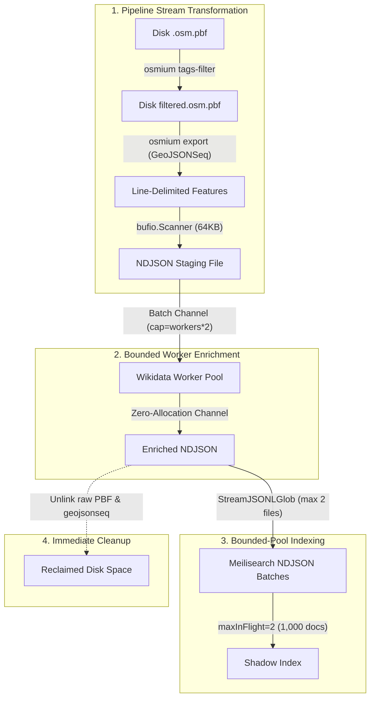

# O(1) Streaming & Memory Architecture

Most OpenStreetMap ingestion pipelines fail on planet-scale datasets because they attempt to load entity graphs or large geographic hierarchies into RAM. In contrast, **Geomilli** is built strictly around **O(1) streaming and disk-first processing**.

Whether processing a single region like Belgium (`BE`, ~70 MB PBF) or the entire Planet (~75 GB PBF), the Go ingestion daemon operates under a **deterministic heap footprint of less than 50 MB RAM**.

---

## The Four Pillars of Low-Memory Ingestion



---

## 1. Zero-Allocation Enrichment Pipeline

### The Problem in Traditional Pipelines
Common ingestion architectures maintain an in-memory buffer or map (e.g. `map[int]Place`) to preserve entity sequence order across parallel workers. If a single external HTTP call (such as a Wikidata or Wikipedia query) stalls or hits rate limits, thousands of pending records accumulate in heap memory, triggering an Out-Of-Memory (OOM) crash.

### Geomilli's Bounded Channel Pattern
Because Meilisearch does not rely on document insertion order, `geomilli-harvester` eliminates accumulator maps entirely:

- Workers read from a **bounded batch channel** (`cap = workers * 2`).
- Workers stream enriched records directly to disk via an atomic mutex-protected or dedicated writer goroutine.
- Memory consumption remains strictly bounded regardless of worker throughput or external API latency.

---

## 2. Bounded File Streaming in the Indexer

When indexing 200+ countries, naive implementations often launch a goroutine and a large `16 MB` scanner buffer for every matched `.ndjson` file simultaneously, demanding several gigabytes of RAM.

In `geomilli-harvester`:
- The indexer processes countries using a **bounded worker pool** (default: 2 concurrent files).
- Each file scanner uses a reusable **`256 KB` buffer**.
- Documents are batched into chunks of **1,000–2,500 records** (`maxInFlight = 2`), applying backpressure to disk reading until Meilisearch acknowledges task ingestion.

---

## 3. Immediate Per-Country Disk Reclaim

Disk space is treated as a finite resource:
1. `raw/*.osm.pbf` and intermediate `.geojsonseq` files for country $N$ are unlinked immediately after producing `staging/places_osm_{code}.ndjson`.
2. Peak disk usage during a multi-country or planet run is proportional to the active country rather than the cumulative sum of all countries.

---

## 4. Meilisearch Indexing Memory Tuning

Meilisearch utilizes LMDB (Lightning Memory-Mapped Database), which is inherently disk-backed. In Docker Compose and Kubernetes configurations, we tune indexing memory to prevent Meilisearch from consuming all host RAM:

```yaml
environment:
  - MEILI_MAX_INDEXING_MEMORY=512Mb
  - MEILI_MAX_INDEXING_THREADS=2
```

With these settings:
- Indexing memory stays capped at 512 MB.
- Operating system page caches handle disk I/O smoothly.
- Search queries remain responsive on the live `places` index during background shadow builds.

---

## Benchmark & Footprint Comparison

| Metric | Traditional OSM Pipelines | Geomilli Harvester |
| :--- | :--- | :--- |
| **Go Process RSS (Belgium)** | ~450 MB | **< 35 MB** |
| **Go Process RSS (Planet)** | 32 GB – 64 GB | **< 65 MB** |
| **Intermediate Storage** | Cumulative (150+ GB) | **Ephemeral (< 5 GB peak)** |
| **Indexing Downtime** | Minutes to Hours | **0 ms (Atomic Swap)** |
