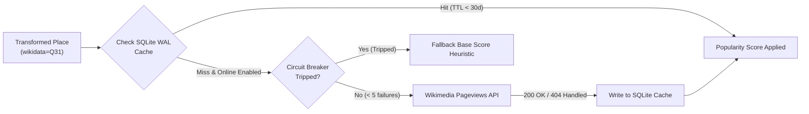

# Enrichment, Caching & Resiliency

To rank search results accurately, Geomilli enriches raw OpenStreetMap places with global popularity metrics derived from **Wikidata IDs** and **Wikipedia Pageviews statistics**.

---

## 1. Enrichment Architecture

---

## 2. SQLite WAL Caching Rules

Because the enrichment stage runs across parallel worker goroutines, SQLite must be configured to prevent concurrency deadlocks (`SQLITE_BUSY`):

### Architectural Constraints:
- **Write-Ahead Logging (WAL)**: `PRAGMA journal_mode = WAL;` allows concurrent readers alongside a single writer.
- **Busy Timeout**: `PRAGMA busy_timeout = 5000;` ensures worker threads retry up to 5 seconds before failing on lock contention.
- **Cache Retention**: Cached records remain valid for `ENRICH_CACHE_TTL_DAYS` (default 30 days) to eliminate redundant outbound requests across re-indexing cycles.

---

## 3. Network Resiliency & Circuit Breaker

Public Wikimedia APIs are subject to rate limiting and intermittent timeouts. Geomilli implements robust error handling:

1. **Silent 404 Handling**:
   - Many OSM entities have Wikidata IDs without corresponding English or target Wikipedia articles.
   - The enrichment client treats HTTP `404 Not Found` silently by returning `(0, nil)`, preventing log spamming and pipeline delays.

2. **Automatic Circuit Breaker**:
   - If **5 consecutive network failures** (e.g., DNS lookup errors, connection timeouts, HTTP 503) occur, the circuit breaker automatically trips.
   - Once tripped, the harvester disables online queries for the remainder of the stage and switches to **offline heuristics**, ensuring the ingestion pipeline finishes reliably even without an internet connection.

3. **Rate Limiting**:
   - Outbound HTTP requests are throttled using a token bucket rate limiter governed by `ENRICH_QPS` (default: 3 requests/sec).

---

## 4. Offline Popularity Heuristics

When `ONLINE_ENRICH=false` or if the circuit breaker trips, Geomilli calculates a normalized `popularity_score` based on deterministic OSM indicators:

$$\text{popularity\_score} = \text{base\_score} + \text{admin\_bonus} + \text{population\_score} + \text{tag\_richness}$$

- **Base Class Score**: Configured in `taxonomy.yaml` (e.g., Country: 100, City: 85, Airport: 95, Hotel: 65, Restaurant: 55).
- **Admin Hierarchy Bonus**: Capitals and administrative centers receive bonuses.
- **Logarithmic Population**: $\log_{10}(\text{population}) \times 4$ for cities with `population=*` tags.
- **Tag Richness**: Entities possessing official websites, phone numbers, or opening hours receive confidence boosts.
