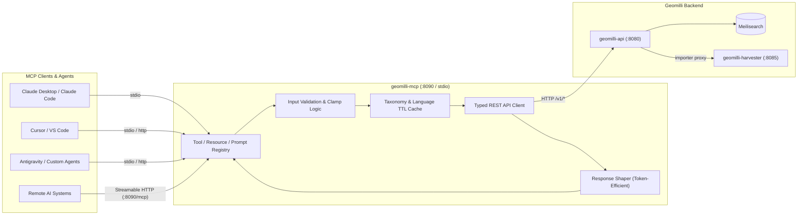

# Model Context Protocol (MCP) Server

The **Geomilli MCP Server** (`geomilli-mcp`) is a lightweight, stateless adapter that exposes Geomilli's high-performance geospatial search engine, OpenStreetMap (OSM) index, and administrative taxonomy directly to AI agents, LLMs, and developer tools using the [Model Context Protocol (MCP)](https://modelcontextprotocol.io/).

Built with the official [`github.com/modelcontextprotocol/go-sdk`](https://github.com/modelcontextprotocol/go-sdk) (v1.x) in Go 1.25, it bridges natural language reasoning with sub-10ms spatial search, forward/reverse geocoding, proximity discovery, and aviation intelligence.

---

## Architecture

Geomilli MCP follows a strict **adapter-only architecture**. It never accesses Meilisearch or SQLite databases directly. Instead, it translates structured MCP tool, resource, and prompt requests into validated calls against the upstream `geomilli-api` REST service (`/v1/*`).

### Architectural Highlights

- **Stateless & Horizontally Scalable**: `geomilli-mcp` holds no persistent in-memory state. You can run multiple instances behind a load balancer with zero coordination.
- **Single Source of Truth**: All geospatial business logic, typo tolerance, coordinate clamping, and ranking algorithms remain centralized in `geomilli-api`.
- **Config-Driven Enums**: Category classes (`class`) and language codes (`lang`) are dynamically pulled from `/v1/taxonomy` and `/v1/languages` at startup and refreshed periodically. No taxonomy logic is ever hardcoded.
- **Token Efficiency**: Raw OSM records contain extensive tag maps and alternative names. `geomilli-mcp` shapes results into compact DTOs (`CompactPlace`) and human-readable text summaries, saving up to 70% of LLM context window tokens.
- **Protocol Safety**: In `stdio` mode, all operational and diagnostic logging is strictly routed to `stderr` using structured `log/slog`. Standard output (`stdout`) is reserved exclusively for JSON-RPC MCP messages to prevent transport corruption.

---

## Dual Transport Support

Geomilli MCP supports both official transports defined by the Model Context Protocol specification:

| Feature | `stdio` Transport (Default) | Streamable `http` Transport |
| :--- | :--- | :--- |
| **Execution Mode** | Local subprocess launched by the MCP client. | Independent HTTP service listening on `:8090`. |
| **Typical Use Cases** | Claude Desktop, Claude Code, Cursor, local IDE agents. | Docker Compose clusters, remote agents, cloud deployments. |
| **Network Attack Surface** | Zero (isolated to the host process tree). | Protected by Bearer token auth & Origin allowlists. |
| **Endpoint** | Standard Input / Output (`stdin`/`stdout`). | `POST /mcp` (Stateless Streamable HTTP). |
| **Logging** | Structured JSON strictly on `stderr`. | Structured JSON on standard logging outputs. |
| **Health Probe** | Process exit code / MCP `ping`. | Native HTTP health check on `GET /healthz`. |

---

## Capabilities Overview

Geomilli MCP exposes 16 tools, 5 resources, and 3 workflow prompts:

### 1. Geospatial Tools (16 Total)

Tools are organized into functional tiers and categories:

* **Geocoding & Location Lookups**:
  * [`geocode`](/mcp/tools-reference#1-geocode): Resolve names, addresses, or queries into coordinate points and enclosing administrative hierarchies.
  * [`reverse_geocode`](/mcp/tools-reference#2-reverse-geocode): Determine the address, administrative hierarchy, and closest landmark for any coordinate pair.
* **Spatial Discovery & POI Search**:
  * [`search_places`](/mcp/tools-reference#3-search-places): Full-text search with structured taxonomy, country, cuisine, and star rating filters.
  * [`find_nearby`](/mcp/tools-reference#4-find-nearby): Radial proximity search around coordinates with distance sorting.
  * [`places_in_area`](/mcp/tools-reference#5-places-in-area): Viewport bounding-box queries (`min_lat`, `min_lng`, `max_lat`, `max_lng`).
  * [`get_place`](/mcp/tools-reference#6-get-place): Deep inspection by OSM primary identifier or Wikidata QID.
* **Aviation & Transit Intelligence**:
  * [`find_airports`](/mcp/tools-reference#7-find-airports): Search international, domestic, and regional airports by name, IATA, ICAO, or coordinate proximity.
  * [`get_airport`](/mcp/tools-reference#8-get-airport): Retrieve full airport specifications by 3-letter IATA or 4-letter ICAO code.
* **Administrative Hierarchy**:
  * [`list_countries`](/mcp/tools-reference#9-list-countries): Discover which countries are indexed in the Geomilli database.
  * [`list_regions`](/mcp/tools-reference#10-list-regions): Query states, provinces, and regions for a given country code.
  * [`list_cities`](/mcp/tools-reference#11-list-cities): List major cities and settlements ordered by population and popularity.
* **Reference & Utilities**:
  * [`list_place_categories`](/mcp/tools-reference#12-list-place-categories): Inspect the 19 canonical taxonomy categories and scoring weights.
  * [`measure_distance`](/mcp/tools-reference#13-measure-distance): Exact Haversine great-circle distance calculation between two points or place IDs.
* **Operations & Cluster Telemetry (Gated)**:
  * [`get_service_status`](/mcp/tools-reference#14-get-service-status): Inspect API health, harvester daemon state, and search metrics.
  * [`list_import_queue`](/mcp/tools-reference#15-list-import-queue): Inspect the active country ingestion pipeline and worker queues.
  * [`list_importable_countries`](/mcp/tools-reference#16-list-importable-countries): View all countries supported for ingestion.

> [!NOTE]
> Tier-2 operations tools are disabled by default. They can be enabled by setting `MCP_ENABLE_OPS_TOOLS=true`.

### 2. Context Resources (`geomilli://`)

Resources provide read-only context documents that LLMs can load directly into their reasoning context:

* `geomilli://taxonomy`: Canonical place categories, match rules, and base scores.
* `geomilli://languages`: Supported language whitelist and localized display names.
* `geomilli://countries`: Indexed countries with entity counts.
* `geomilli://schema/place`: Markdown documentation of the `Place` document schema and coordinate formats.
* `geomilli://places/{id}`: Dynamic URI template for retrieving full place documents by ID.

For complete documentation, see the [Resources & Prompts Guide](/mcp/resources-and-prompts).

### 3. Guided Workflow Prompts

Predefined prompt templates guide LLMs through complex multi-step spatial reasoning workflows:

* `explore_area`: Forward geocodes a destination and discovers curated attractions, dining, and cultural sights.
* `describe_location`: Reverse geocodes coordinates and synthesizes a vivid administrative and geographical narrative.
* `plan_airport_transfer`: Discovers airports serving a city, measures direct transit distances, and compares transit options.

---

## Getting Started

1. **Configure your AI client**: Read the [Client Setup Guide](/mcp/client-setup) for copy-paste configurations for Claude Desktop, Claude Code, Cursor, and VS Code.
2. **Explore available tools**: Review parameter definitions and sample outputs in the [Tools Reference](/mcp/tools-reference).
3. **Deploy to production**: Consult the [Security & Deployment Guide](/mcp/security-and-deployment) for Docker Compose, Kubernetes, Bearer authentication, and Origin filtering.
