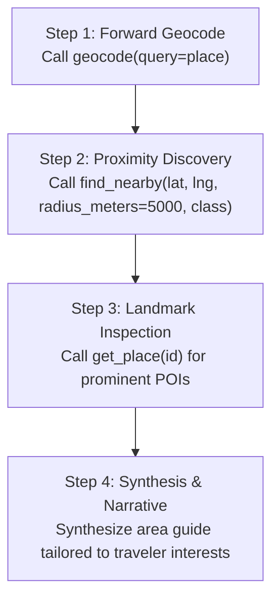

# Context Resources & Workflow Prompts

The Model Context Protocol enables servers to provide two powerful complementary primitives alongside tools: **Resources** (structured context documents and knowledge bases that models can read) and **Prompts** (reusable, multi-step agentic workflow templates).

---

## 1. Context Resources (`geomilli://`)

Resources expose read-only documents and knowledge graphs using the custom URI scheme `geomilli://`. Unlike tools (which execute dynamic functions), resources can be attached directly into the conversation context by the user or client.

### Available Resources

| URI | MIME Type | Description |
| :--- | :--- | :--- |
| `geomilli://taxonomy` | `application/json` | Complete taxonomy configuration (19 canonical classes, layers, base scores, subclasses). |
| `geomilli://languages` | `application/json` | Supported language whitelist with ISO codes and localized display names. |
| `geomilli://countries` | `application/json` | Currently indexed countries in the Geomilli database with total entity counts. |
| `geomilli://schema/place` | `text/markdown` | Human- and machine-readable schema definition for the canonical `Place` document model. |
| `geomilli://places/{id}` *(Template)* | `application/json` | Dynamic resource template for direct place document lookups by primary identifier. |

> [!TIP]
> **Tool & Resource Parity**: While resources offer a clean URI-based retrieval mechanism, some MCP clients currently have incomplete resource support. For this reason, Geomilli maintains 100% functional parity: every resource has a direct tool equivalent (`list_place_categories`, `list_countries`, `get_place`).

---

### Resource Definitions

#### `geomilli://taxonomy`
Returns the complete taxonomy mapping used by Geomilli to categorize OpenStreetMap features into 19 canonical classes:
```json
{
  "classes": [
    {
      "name": "City",
      "layer": "admin",
      "base_score": 0.90,
      "subclasses": ["city", "town", "municipality"]
    },
    {
      "name": "Airport",
      "layer": "poi",
      "base_score": 0.85,
      "subclasses": ["international", "regional", "aerodrome"]
    },
    {
      "name": "Attraction",
      "layer": "poi",
      "base_score": 0.80,
      "subclasses": ["monument", "museum", "theme_park", "viewpoint"]
    }
  ]
}
```

#### `geomilli://languages`
Returns the whitelist of supported language codes and their native names:
```json
{
  "default_language": "en",
  "supported_languages": [
    { "code": "en", "name": "English" },
    { "code": "fr", "name": "Français" },
    { "code": "nl", "name": "Nederlands" },
    { "code": "de", "name": "Deutsch" },
    { "code": "es", "name": "Español" }
  ]
}
```

#### `geomilli://countries`
Returns the list of countries currently ingested and searchable in Meilisearch:
```json
{
  "total_countries": 1,
  "countries": [
    {
      "country_code": "BE",
      "country_name": "Belgium",
      "total_places": 142500,
      "last_updated": "2026-10-24T12:00:00Z"
    }
  ]
}
```

#### `geomilli://schema/place`
Exposes the authoritative Markdown specification for the `Place` document. It explains:
- Primary key formatting (`osm_{type}{id}`).
- Coordinate representation (WGS 84 EPSG:4326, `_geo.lat`, `_geo.lng`, and `bbox` arrays).
- Administrative boundary levels (`admin_level` 2 = Country, 4 = Region/State, 8 = Municipality/City).
- Composite `popularity_score` algorithm:
  $$\text{Popularity} = \text{BaseScore} \times 0.4 + \log_{10}(\text{Pageviews} + 1) \times 0.3 + \text{Sitelinks} \times 0.2 + \text{HierarchyBoost} \times 0.1$$

#### `geomilli://places/{id}` (Resource Template)
Allows clients to retrieve any place directly by URI. For example, querying `geomilli://places/osm_w157053075` returns the complete place record for the Grand Place in Brussels.

---

## 2. Guided Workflow Prompts

MCP Prompts are server-defined prompt templates that assist AI models in executing multi-step geospatial workflows systematically. When invoked, they generate structured prompt instructions tailored to the user's input arguments.

### 1. `explore_area`

Guides the model through discovering, analyzing, and recommending points of interest (POIs) around any landmark, neighborhood, or city.

#### Prompt Arguments

| Name | Type | Required | Description |
| :--- | :--- | :--- | :--- |
| `place` | `string` | **Yes** | Destination name (e.g. `"Montmartre, Paris"`, `"Atomium"`, `"Shibuya, Tokyo"`). |
| `interests` | `string` | No | Focus categories or hobbies (e.g. `"cafes, art museums, historic architecture"`). |

#### Step-by-Step Workflow Executed by the Agent



#### Example Usage in Claude or Cursor

Select **explore_area** from the prompt menu and provide:
- **place**: `Atomium, Brussels`
- **interests**: `parks, science museums, Belgian dining`

The model receives clear step-by-step instructions:
1. Resolve coordinates using `geocode("Atomium, Brussels")`.
2. Discover attractions within 3–5 km using `find_nearby`.
3. Inspect details using `get_place`.
4. Synthesize a vivid travel itinerary and area overview.

---

### 2. `describe_location`

Instructs the agent to reverse-geocode a geographic coordinate, discover surrounding landmarks, and write an accurate geographic description.

#### Prompt Arguments

| Name | Type | Required | Description |
| :--- | :--- | :--- | :--- |
| `lat` | `string` / `number` | **Yes** | Latitude coordinate in decimal degrees (-90 to 90). |
| `lng` | `string` / `number` | **Yes** | Longitude coordinate in decimal degrees (-180 to 180). |

#### Step-by-Step Workflow Executed by the Agent

1. **Reverse Geocode**: Call `reverse_geocode` with `lat` and `lng` to identify the address, administrative hierarchy (neighborhood, municipality, province, country), and closest identified place.
2. **Surrounding Landmarks**: Call `find_nearby` with `radius_meters=5000` to find notable transit hubs, attractions, or commercial centers in the immediate vicinity.
3. **Geographic Narrative**: Synthesize a comprehensive description covering administrative jurisdiction, physical character (urban, suburban, rural, or industrial), and notable neighboring landmarks with exact distances.

---

### 3. `plan_airport_transfer`

Evaluates transit and transfer options from a city center to surrounding commercial airports.

#### Prompt Arguments

| Name | Type | Required | Description |
| :--- | :--- | :--- | :--- |
| `city` | `string` | **Yes** | Target city name (e.g. `"Brussels"`, `"San Francisco"`, `"London"`). |

#### Step-by-Step Workflow Executed by the Agent

1. **Geocode City Center**: Call `geocode` with `query=city` to pinpoint the central coordinates and administrative region.
2. **Discover Serving Airports**: Call `find_airports` with `query=city` to locate international, domestic, and regional airports.
3. **Measure Direct Distances**: For each airport discovered, call `measure_distance` from the city center coordinates to calculate exact transit distances in kilometers and miles.
4. **Compare & Recommend**: Provide an objective comparison:
   - Primary international gateway vs. secondary/budget airline hubs.
   - Distance, IATA/ICAO codes, and cardinal orientation from the city center.
   - Practical guidance for travelers selecting flight routes.
