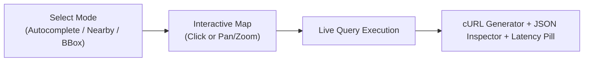

# Studio UI & Playground Guide

**Geomilli Studio** is the unified developer console and operations cockpit for Geomilli, served at `http://localhost:3000`.

---

## 1. Interactive API Playground Tab

The Playground lets you test and visualize every endpoint using live MapLibre GL maps with zero external API keys.

### Modes Supported:
1. **Autocomplete**: Test keystroke response times with prefix matching, language switches (`en`, `fr`, `nl`), and taxonomy class filters.
2. **Search & Facets**: Explore faceted distributions (e.g., star ratings, cuisines) with real-time checkbox filtering and custom sort orders.
3. **Reverse Geocoding**: Click anywhere on the map to drop a pin. The UI renders the enclosing administrative hierarchy and nearest street address.
4. **Nearby POIs (Radius)**: Drag a slider to set radius (e.g. 500m to 5km). A circular boundary renders on the map highlighting all contained places.
5. **Bounding Box (Viewport)**: Pan and zoom across the map. As the viewport changes, places inside the bounding box stream into the view.
6. **Airports & Entity Details**: Search by 3-letter IATA code (`BRU`, `LHR`, `JFK`) or inspect complete OSM and Wikidata tags.

### Developer Features:
- **One-Click cURL**: Generates the exact, reproducible `curl` command targeting the Go API backend (`http://localhost:8080`) with URL-encoded parameters for your terminal.
- **Quick-Clear Query `(X)`**: Instantly clear text queries to browse entire categories or countries by filter alone.
- **Auto-Relaxed Class Switching**: Clicking a taxonomy pill automatically relaxes initial demo keywords so you immediately see entities for that class.
- **Latency Pill**: Highlights Meilisearch query execution time (e.g. `2.8 ms`) and total HTTP roundtrip.
- **Raw JSON Inspector**: Formatted JSON response with syntax highlighting and copy-to-clipboard.

---

## 2. Importer Control Center Tab

Monitor background streaming ingestion jobs in real time:

- **Pipeline Stage Visualizer**: Displays active state across `Fetch` ➔ `Filter` ➔ `Transform` ➔ `Enrich` ➔ `Index` ➔ `Swap`.
- **Dynamic Country Manager**: Browse all Geofabrik countries. Select additional countries (e.g., `Netherlands (NL)`, `Luxembourg (LU)`) and click **"Import Selected Countries"** to queue new ingestion jobs without restarting the server.
- **Resource Efficiency Gauges**:
  - **Go Heap RSS**: Monitors harvester memory, verifying it stays below 50 MB.
  - **Disk Staging**: Displays current temporary disk footprint.
  - **SQLite Cache**: Hits vs. misses for Wikidata entity enrichment.
- **Live Terminal Logs**: Real-time SSE streaming log viewer.

---

## 3. Metrics & Telemetry Tab

Tracks production health and query performance:

- **Connection Badge**: Shows whether connected to **Local Meilisearch** or **Meilisearch Cloud**, index document count, and database size on disk.
- **Traffic & Latency Percentiles**: Live charts tracking QPS alongside `p50`, `p95`, and `p99` latency.
- **Endpoint Breakdown**: Distribution of calls across `/autocomplete`, `/search`, `/reverse`, and `/nearby`.
- **Top Queries & Zero-Hit Analytics**: Identifies popular searches and queries returning 0 hits to help refine taxonomy or synoynms.
