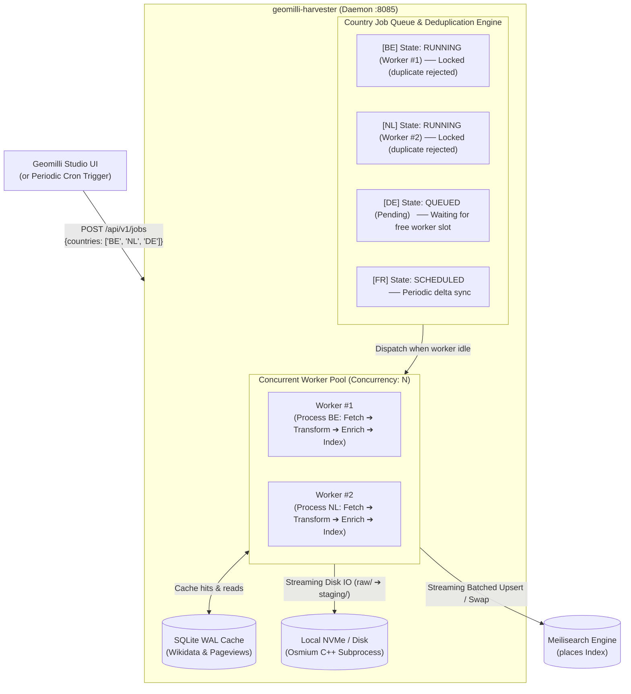

# geomilli-harvester

> **Low-memory, disk-first streaming OpenStreetMap ingestion pipeline & control daemon for Geomilli.**

`geomilli-harvester` downloads, filters, normalizes, enriches, and indexes OpenStreetMap (OSM) data into **Meilisearch** with an $O(1)$ RAM footprint. It can run as a **CLI tool** (for one-shot imports and Kubernetes CronJobs) or as a **Daemon** with a real-time HTTP & Server-Sent Events (SSE) API to control dynamic country imports and monitor ingestion progress.

---

## Features

- **Strictly Bounded Memory ($O(1)$ RAM)**:
  - **Streaming Transformation**: Streams directly from disk PBFs through `osmium` to `.geojsonseq` and NDJSON without holding full datasets in RAM.
  - **Bounded Enrichment Buffer**: Replaces unbounded reorder maps with a bounded channel (`cap = workers * 2`), preventing memory spikes when external requests stall.
  - **Bounded Indexing Worker Pool**: Reads country NDJSON files through a bounded pool (default 2 concurrent files) using small 256 KB reusable buffers and small batches (`2,000` docs/batch, `maxInFlight = 2`).
- **Immediate Disk Cleanup**: Cleans raw PBFs and intermediate `.geojsonseq` files per-country as soon as the normalized `.ndjson` is generated.
- **SQLite WAL Cache**: Caches Wikidata sitelinks and Wikipedia pageviews locally in SQLite WAL mode with circuit breaking on network failures.
- **Blue/Green Atomic Swaps**: Builds into an isolated shadow index (`places__build_<timestamp>`), runs golden query validation, and atomically swaps aliases with zero downtime.
- **Async Worker Queue & Deduplication Engine**: Bounded concurrent worker pool (`HARVESTER_CONCURRENCY=2`) with country-level mutex locks preventing duplicate or overlapping runs.
- **Control Daemon & Real-Time SSE**: Exposes `/api/v1/status`, `/api/v1/queue`, `/api/v1/countries`, `/api/v1/jobs`, and `/api/v1/events` on port `8085`.
- **Belgium (`BE`) Default**: Defaults to Belgium (`BE`, `europe/belgium`) for quick 2-minute local development setup.

---

## Architecture Pipeline

```text
Geofabrik PBF
   │
   ▼
[osmium tags-filter]  ──▶  Admin & POI PBFs
   │
   ▼
[osmium export]       ──▶  .geojsonseq (Streaming Feature Collection)
   │
   ▼
[transform-places]    ──▶  staging/places_osm_{code}.ndjson (Normalized Schema)
   │
   ▼
[enrich-places]       ──▶  staging/places_{code}.ndjson (SQLite WAL + Wikidata Popularity)
   │
   ▼
[index]               ──▶  Meilisearch (places__build_*) + Golden Queries Validation
   │
   ▼
[swap-indexes]        ──▶  Atomic Swap to live "places" index
   │
   ▼
[cleanup]             ──▶  Remove staging & old build indexes
```

### Worker Queue & Country Deduplication Flow



---

## Quickstart

### Prerequisites

- Go 1.25+
- `osmium-tool` installed locally (`brew install osmium-tool` on macOS)
- A running Meilisearch instance (default `http://127.0.0.1:7700`)

### 1. Configure Environment

```bash
cp .env.example .env
```

Default settings:
- `COUNTRIES=BE`
- `MEILI_HOST=http://127.0.0.1:7700`
- `HARVESTER_PORT=8085`
- `AUTO_IMPORT=true`

### 2. Run Harvester Daemon (Recommended)

Start the control daemon listening on port `8085`:

```bash
make serve
# or: go run ./cmd/harvester serve --port 8085
```

If the `places` index in Meilisearch is empty, it automatically triggers an initial import of Belgium (`BE`).

### 3. Run One-Shot CLI Import

To run the pipeline sequentially from the command line:

```bash
make run
# or: go run ./cmd/harvester run --stage run
```

With online Wikidata enrichment enabled:

```bash
make refresh
# or: ENRICH_ONLINE=true go run ./cmd/harvester run --online-enrich=true
```

---

## Daemon API Reference (`:8085`)

### 1. Pipeline Status & Metrics
`GET /api/v1/status`

```json
{
  "state": "running",
  "active_job": {
    "job_id": "job_1774314000",
    "countries": ["BE"],
    "current_country": "BE",
    "stage": "enrich",
    "progress_pct": 65,
    "docs_processed": 142500,
    "started_at": "2026-10-23T04:15:00Z"
  },
  "resources": {
    "heap_alloc_mb": 24.5,
    "sys_mem_mb": 48.2,
    "disk_staging_mb": 112.0,
    "disk_cache_mb": 18.4,
    "sqlite_cache_entries": 4210
  },
  "history": []
}
```

### 2. Available Countries
`GET /api/v1/countries`

Returns all Geofabrik countries defined in `config/countries.yaml`, indicating their indexing and cache status.

```json
{
  "countries": [
    {
      "code": "BE",
      "name": "Belgium",
      "geofabrik_path": "europe/belgium",
      "is_indexed": true,
      "last_built_at": "2026-10-23T04:16:30Z"
    },
    {
      "code": "NL",
      "name": "Netherlands",
      "geofabrik_path": "europe/netherlands",
      "is_indexed": false
    }
  ]
}
```

### 3. Trigger Ingestion Job
`POST /api/v1/jobs`

```json
{
  "countries": ["BE", "NL"],
  "online_enrich": false,
  "mode": "append"
}
```

**Response (`202 Accepted`)**:
```json
{
  "job_id": "job_1774314500",
  "message": "job started",
  "status": "running"
}
```

*Returns `409 Conflict` if a job is already in progress.*

### 4. Real-Time Server-Sent Events (SSE)
`GET /api/v1/events`

Streams real-time stage progression and log output:

```text
event: progress
data: {"job_id":"job_1774314000","stage":"enrich","current_country":"BE","progress_pct":65,"docs_processed":142500,"timestamp":"2026-10-23T04:15:30Z"}

event: log
data: {"timestamp":"2026-10-23T04:15:31Z","level":"info","message":"[job_1774314000] enriching places for BE (online=false)..."}
```

---

## Configuration Files

- `config/countries.yaml`: Whitelist of country codes, human names, and Geofabrik download paths.
- `config/taxonomy.yaml`: 19-class taxonomy hierarchy (City, Airport, Hotel, Restaurant, etc.), OSM tag rules, and base score weights.
- `config/languages.yaml`: Whitelisted language codes for name normalization.
- `config/golden_queries_places.txt`: Golden validation queries run against the shadow index before atomic swap.

---

## Docker Build

Build the production Debian container:

```bash
docker build -t geomilli-harvester:latest .
```

Run in daemon mode:

```bash
docker run -d \
  -p 8085:8085 \
  -e MEILI_HOST=http://host.docker.internal:7700 \
  -e COUNTRIES=BE \
  geomilli-harvester:latest
```
